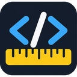

<div align="center">
  
  <h1>Align Ruler</h1>
  <p>
    
    
    
  </p>
</div>

A browser extension that overlays a crosshair ruler and draggable guides on any web page, so front-end developers and designers can check whether HTML elements are aligned down to the pixel.

## Features

- **Crosshair ruler** that follows the cursor and snaps to nearby element edges and centers; the line turns green where edges are aligned.
- **Near-miss detection**: edges within 8px of the ruler but outside the tolerance are highlighted in red with their offset.
- **Persistent guides**: pin the ruler as horizontal/vertical guides, drag them with snapping, nudge them with the arrow keys and remove them by double-click or by dragging them off-screen.
- **Inspect mode**: click an element to pin it as a reference, then hover over others to compare left/center/right, top/center/bottom, width and height deltas and the gaps between them.
- **Box highlighting** with four modes: none, all, only misaligned, only aligned.
- **Adjustable tolerance** (0–20px, default 1px) and optional pixel ticks on the ruler.
- **Shadow DOM aware**: it descends into open web components when it detects elements.
- **Isolated overlay**: rendered in the top layer, above any page `z-index`, including open dialogs.
- **Single on/off switch**: turning it off in one tab turns it off in every tab. The toolbar badge shows `ON` on tabs where it is active.
- Display preferences (ticks, box mode, details panel) are stored in `chrome.storage.local` and shared across pages.

## Keyboard Shortcuts

| Key | Action |
|---|---|
| `Alt+Shift+R` | Toggle the extension (same as clicking the toolbar icon) |
| `Shift` (hold) | Free ruler, no snapping |
| `S` | Toggle snapping |
| `C` | Toggle the crosshair ruler |
| `T` | Toggle pixel ticks |
| `B` | Cycle box mode: none → all → misaligned → aligned |
| `D` | Toggle the details panel and coordinate label |
| `?` | Toggle the help section in the details panel |
| `Space` | Pin the current ruler position as horizontal + vertical guides |
| `H` / `V` | Add only a horizontal / vertical guide at the cursor |
| `←` `↑` `↓` `→` | Move the selected guide by 1px (`Shift` = 10px) |
| `X` / `Delete` / `Backspace` | Delete the selected guide |
| `G` | Delete all guides |
| `I` | Toggle inspect mode (page clicks are blocked) |
| `Click` / `Shift+Click` | Pin an element as a reference / add or remove an extra pinned element (inspect mode) |
| `P` / `N` | Select the parent / child of the hovered element |
| `+` / `-` | Increase / decrease the alignment tolerance |
| `Esc` | Clear pins and selection, or exit if nothing is selected |

Shortcuts are ignored while typing in inputs, textareas, selects and `contenteditable` elements, except for `Esc`.

## Tech Stack

- **Vanilla JavaScript**, with no dependencies and no build step.
- **WebExtensions Manifest V3**:
  - `background.js`: service worker that injects the content script, tracks active tabs in `chrome.storage.session` and syncs the badge and the global off switch.
  - `content.js`: overlay, ruler, guides, alignment calculations and the details panel, rendered inside a Shadow DOM host.
- Permissions: `activeTab`, `scripting`, `storage`.

## Requirements

- Chromium-based browser with Manifest V3 support (Chrome, Edge, Brave, …), or
- Firefox 128 or later (`strict_min_version` in `manifest.json`)

## Installation

```bash
git clone https://github.com/FabioLace/Ruler-Extension.git
cd Ruler-Extension
```

### Chrome / Chromium

1. Open `chrome://extensions`.
2. Enable **Developer mode**.
3. Click **Load unpacked** and select the project folder.

### Firefox

1. Open `about:debugging#/runtime/this-firefox`.
2. Click **Load Temporary Add-on…** and select `manifest.json`.

## Usage

Click the toolbar icon or press `Alt+Shift+R` on any page. Press `D` to open the details panel with the full list of shortcuts, and `Esc` to exit.

The extension cannot run on restricted pages such as `chrome://` URLs, the Chrome Web Store or the built-in PDF viewer.

## Testing

There is no automated test suite. `test/test.html` is a manual test page with cards that are aligned, misaligned by 3px and misaligned by 0.5px, plus a button to check that clicks are blocked in inspect mode.

Open it in the browser and toggle the extension. In Chrome, local `file://` pages also require **Allow access to file URLs** to be enabled in the extension's details page.

## Project Structure

```
Ruler-Extension/
├── manifest.json   # Extension manifest (MV3, Chrome + Firefox settings)
├── background.js   # Service worker: injection, badge, cross-tab on/off state
├── content.js      # Overlay UI, ruler, guides and alignment logic
├── icons/          # Toolbar and store icons (16, 32, 48, 128 px)
└── test/
    └── test.html   # Manual test page with aligned and misaligned elements
```
